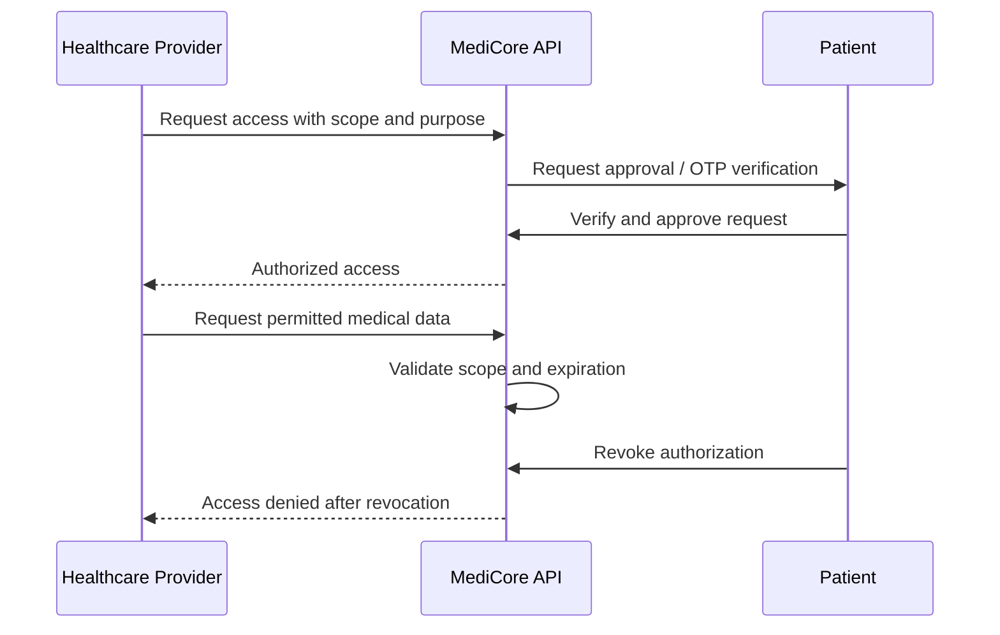

# MediCore — Healthcare Management API

A secure, consent-driven Electronic Health Record (EHR) platform designed to connect patients, doctors, hospitals, pharmacies, and laboratories through a unified medical identity.

MediCore is a backend-focused healthcare platform built with **ASP.NET Core Web API, Clean Architecture, Entity Framework Core, and SQL Server**. It focuses on secure medical data management, patient-controlled access, identity management, and healthcare workflows.


---

## Table of Contents

- [Overview](#overview)
- [Key Features](#key-features)
- [Architecture](#architecture)
- [Technology Stack](#technology-stack)
- [User Roles and Authorization](#user-roles-and-authorization)
- [Core Workflows](#core-workflows)
- [API Overview](#api-overview)
- [Getting Started](#getting-started)
- [Configuration](#configuration)
- [Security Considerations](#security-considerations)
- [Project Structure](#project-structure)
- [Roadmap](#roadmap)
- [Contributing](#contributing)
- [License](#license)

---

## Overview

Healthcare information is often distributed across hospitals, pharmacies, and laboratories, making secure access and continuity of care challenging.

MediCore provides a centralized backend for managing medical records and healthcare workflows while giving patients control over access to their sensitive information.

### Core principles

- **Patient-controlled access:** Healthcare providers request permission before accessing protected patient records.
- **Least privilege:** Access can be restricted by resource scope and authorization duration.
- **Secure identity management:** Authentication, OTP verification, and role-based authorization.
- **Separation of concerns:** Business logic, domain rules, infrastructure, and API delivery are organized into distinct architectural layers.
- **Traceability:** Sensitive operations can be recorded through an audit logging mechanism.

> **Project status:** Portfolio and development project. A successful build or implemented security feature does not by itself establish production readiness or regulatory compliance.

## Key Features

### Authentication and Identity

- Role-based registration and onboarding workflows.
- Email OTP verification for supported authentication flows.
- JWT Bearer authentication.
- Refresh-token workflows.
- ASP.NET Core Identity integration.
- Approval workflows for healthcare providers and organizations.
- Protected registration state using ASP.NET Core Data Protection.

### Medical Records Management

- Patient medical profiles and records.
- Versioned medical records that preserve previous versions.
- Medical file uploads and record attachments.
- Patient allergies, chronic conditions, and medication history.
- Emergency contact management.

### Patient-Controlled Access Authorization

- Provider access requests with a specified purpose.
- Scoped access to medical records and related resources.
- OTP-based verification within the access workflow.
- Patient approval, rejection, and revocation.
- Time-limited authorizations.
- Ownership-based authorization policies.

Supported access scopes include:

- `FullMedicalRecord`
- `PrescriptionsOnly`
- `LabResultsOnly`
- `SpecificFile`

### Prescription and Pharmacy Management

- Prescription creation and verification.
- Prescription items and medication catalogs.
- Per-item dispensing workflows.
- Pharmacist shift management.
- Prescription lifecycle management, including partial and complete dispensing.

### Laboratory Management

- Lab test requests initiated by doctors.
- Assignment of requests to laboratories.
- Sample collection and processing workflows.
- Lab technician management.
- Uploading and managing test results.

### Platform and API Capabilities

- RESTful API endpoints organized by feature.
- Global exception-handling middleware.
- Swagger / OpenAPI documentation.
- Policy-based and resource-based authorization.
- Configurable rate-limiting policies.
- Soft deletion and controlled permanent deletion.
- Entity Framework Core migrations and data seeding.
- Audit logging support for sensitive operations.

---

## Architecture

MediCore follows **Clean Architecture**, separating domain logic from application use cases, infrastructure implementations, and HTTP delivery.

```text
MediCore
│
├── API
│   ├── Controllers
│   ├── Authorization
│   ├── Middleware
│   └── Program.cs
│
├── Application
│   ├── Services
│   ├── DTOs
│   ├── Interfaces
│   └── Exceptions
│
├── Domain
│   ├── Entities
│   ├── Enums
│   ├── Common
│   └── Exceptions
│
└── Infrastructure
    ├── Persistence
    ├── Repositories
    ├── Identity
    ├── ExternalServices
    └── Migrations
```

### Layer Responsibilities

| Layer | Responsibility |
|---|---|
| **Domain** | Core entities, enums, and domain rules. |
| **Application** | Application services, DTOs, interfaces, and use-case logic. |
| **Infrastructure** | Database access, repositories, Identity, email delivery, and external service implementations. |
| **API** | HTTP endpoints, request handling, middleware, authentication, and authorization configuration. |

### Dependency Direction

```text
API ───────────────► Application
Infrastructure ────► Application
Infrastructure ────► Domain
Application ───────► Domain
```

The Domain layer remains independent of infrastructure and API concerns.

### Design Patterns and Practices

- Repository Pattern
- Unit of Work
- Dependency Injection
- Data Transfer Objects (DTOs)
- Separation of Concerns
- Policy-based Authorization
- Resource Ownership Checks
- Strategy Pattern for supported notification channels

---

## Technology Stack

| Category | Technology |
|---|---|
| Framework | ASP.NET Core Web API |
| Runtime | .NET 8 |
| Language | C# |
| ORM | Entity Framework Core 8 |
| Database | Microsoft SQL Server |
| Identity | ASP.NET Core Identity |
| Authentication | JWT Bearer |
| Email | MailKit / SMTP |
| API Documentation | Swagger / Swashbuckle |
| Data Protection | ASP.NET Core Data Protection |
| API Protection | ASP.NET Core Rate Limiting |
| Database Versioning | EF Core Migrations |

---

## User Roles and Authorization

MediCore supports multiple user roles with different responsibilities and access permissions.

| Role | Responsibilities |
|---|---|
| `SuperAdmin` | Platform administration, organization approvals, and privileged administrative operations. |
| `HospitalAdmin` | Hospital, department, and doctor management. |
| `PharmacyAdmin` | Pharmacy and pharmacist management. |
| `LabAdmin` | Laboratory and lab technician management. |
| `Doctor` | Medical records, prescriptions, and lab test requests. |
| `Pharmacist` | Prescription verification and dispensing. |
| `LabTechnician` | Sample processing and laboratory result management. |
| `Patient` | Medical profile management and granting or revoking access. |

Authorization goes beyond role checks. Ownership policies are designed to restrict access to resources based on the current user's permissions and relationship to the resource.

Examples include:

- `PatientOwnerOrAdmin`
- `DoctorOwnerOrAdmin`
- `PrescriptionOwnerOrAdmin`
- `MedicalRecordOwnerOrAdmin`

The exact permissions depend on the applicable authorization policies and endpoint configuration.

---

## Core Workflows

### 1. Patient-Controlled Medical Record Access



The workflow is designed to ensure that access is limited to the granted permissions and authorization period.

### 2. OTP-Based Authentication

The supported authentication flow includes:

1. Request an OTP for registration.
2. Verify the OTP and complete account registration.
3. Request an OTP for login.
4. Verify the login OTP and receive authentication tokens.
5. Refresh tokens through the refresh endpoint.
6. End the session through the logout endpoint.

OTP expiration, verification attempts, and token handling should follow the configured implementation.

### 3. Prescription and Dispensing

```text
Doctor
  │
  ▼
Create Prescription
  │
  ▼
Add Prescription Items
  │
  ▼
Verify Prescription
  │
  ▼
Pharmacist Dispenses Items
  │
  ▼
Update Dispensing Status
```

Prescription status can reflect whether items are awaiting dispensing, partially dispensed, fully dispensed, cancelled, or expired.

### 4. Laboratory Test Processing

```text
Doctor
  │
  ▼
Create Lab Test Request
  │
  ▼
Assign Laboratory
  │
  ▼
Sample Collection and Processing
  │
  ▼
Upload Test Results
  │
  ▼
Results Available to Authorized Users
```

---

## API Overview

The API is organized into feature-based controllers and REST endpoints.

Interactive API documentation is provided through Swagger when enabled by the application configuration.

### Main API Areas

| Feature | Base Route |
|---|---|
| Authentication | `/api/Auth` |
| OTP | `/api/OTP` |
| Patients | `/api/Patient` |
| Doctors | `/api/Doctor` |
| Hospitals | `/api/Hospital` |
| Departments | `/api/Department` |
| Hospital Administration | `/api/HospitalAdmin` |
| Pharmacy Administration | `/api/PharmacyAdmin` |
| Laboratory Administration | `/api/LabAdmin` |
| Pharmacies | `/api/Pharmacies` |
| Pharmacists | `/api/Pharmacist` |
| Laboratories | `/api/labs` |
| Lab Technicians | `/api/lab-technicians` |
| Lab Tests | `/api/lab-tests` |
| Lab Test Requests | `/api/lab-test-requests` |
| Access Requests | `/api/AccessRequest` |
| Medical Records | `/api/MedicalRecord` |
| Medical Files | `/api/medicalrecords/{medicalRecordId}/files` |
| Prescriptions | `/api/prescriptions` |
| Medications | `/api/Medication` |
| Allergies | `/api/Allergies` |
| Chronic Diseases | `/api/ChronicDiseases` |
| Patient Medical Conditions | `/api/PatientMedicalCondition` |
| Patient Medications | `/api/PatientMedication` |
| Emergency Contacts | `/api/EmergencyContact` |

> Routes and available operations should be verified against the current controller implementation. Authentication requirements and permitted roles vary by endpoint.

### Rate Limiting

The application defines rate-limiting policies for selected request categories.

| Policy | Configured Limit | Intended Use |
|---|---|---|
| `AuthLimiter` | 5 requests/minute/IP | Authentication and registration |
| `OTPLimiter` | 10 requests/minute/IP | OTP operations |
| `SmallDataLimiter` | 60 requests/minute/user | Individual resource reads |
| `BigDataLimiter` | 20 requests/minute/user | Collection and list endpoints |

Requests exceeding an applicable limit may receive `429 Too Many Requests`.

---

## Getting Started

### Prerequisites

Install the following tools before running the application:

- [.NET 8 SDK](https://dotnet.microsoft.com/download/dotnet/8.0)
- [SQL Server](https://www.microsoft.com/sql-server) or SQL Server Express / LocalDB
- An SMTP account for email delivery, if required by the selected workflows
- Entity Framework Core CLI

Install the EF Core CLI if it is not already available:

```bash
dotnet tool install --global dotnet-ef
```

### 1. Clone the Repository

Replace the URL below with the actual public repository URL.

```bash
git clone https://github.com/<your-username>/MediCore-Backend.git
cd MediCore-Backend
```

### 2. Restore Dependencies

```bash
dotnet restore
```

### 3. Configure User Secrets

Navigate to the API project directory. The project directory may retain its original `PulseID.API` name if the solution has not been renamed internally.

```bash
cd PulseID.API
dotnet user-secrets init
```

Configure the required settings using your own development credentials:

```bash
dotnet user-secrets set "ConnectionStrings:DefaultConnection" "<your-connection-string>"

dotnet user-secrets set "Jwt:Secret" "<your-long-random-secret>"

dotnet user-secrets set "Email:SenderEmail" "<your-sender-email>"

dotnet user-secrets set "Email:SenderPassword" "<your-smtp-app-password>"
```

Configure any additional required settings according to the application's configuration and service registrations.

**Never commit actual credentials or production secrets to source control.**

### 4. Apply Database Migrations

From the API project directory, assuming the project directories retain the names shown below:

```bash
dotnet ef database update --project ../PulseID.Infrastructure --startup-project .
```

Make sure the configured SQL Server instance is reachable and the database connection string is valid.

### 5. Run the API

```bash
dotnet run
```

Open the Swagger UI URL printed in the application output, typically:

```text
https://localhost:<port>/swagger
```

The port depends on the local launch configuration.

---

## Configuration

Application settings are managed through `appsettings.json`, User Secrets during development, and environment variables in deployed environments.

| Setting | Purpose |
|---|---|
| `ConnectionStrings:DefaultConnection` | SQL Server connection string |
| `Jwt:Secret` | JWT signing key |
| `Jwt:Issuer` | Token issuer |
| `Jwt:Audience` | Token audience |
| `Jwt:ExpiryMinutes` | Access token lifetime |
| `Email:SmtpHost` | SMTP server hostname |
| `Email:SmtpPort` | SMTP server port |
| `Email:SenderEmail` | Sender email address |
| `Email:SenderPassword` | SMTP credential or app password |
| `Email:SenderDisplayName` | Sender display name |
| `Email:EnableSsl` | SMTP TLS configuration |
| `FileStorage:RootPath` | Optional file storage directory |

For environment variables, use double underscores to represent nested configuration keys. For example:

```text
Jwt__Secret
ConnectionStrings__DefaultConnection
Email__SenderPassword
```

### File Uploads

The application configuration defines file upload limits and permitted extensions for supported upload categories.

| Category | Configured Maximum | Supported Formats |
|---|---|---|
| Personal images | 10 MB | Supported image formats |
| Medical files | 25 MB | PDF, images, Office documents, TXT, and DICOM |

Actual permitted formats and limits should be verified against the upload validation code.

### CORS

The API configures cross-origin access through its CORS policy.

Before deploying, configure the allowed origins to match the intended frontend applications. Avoid allowing arbitrary origins in production unless explicitly required and safely configured.

---

## Security Considerations

Security is an important part of the platform's design.

### Implemented or Configured Security Mechanisms

Depending on the relevant endpoint and service implementation, these include:

- JWT Bearer authentication.
- Role-based and resource-based authorization.
- Patient-controlled access authorization workflows.
- OTP verification and expiration handling.
- Protected registration state using ASP.NET Core Data Protection.
- Rate limiting for selected endpoints.
- Global exception handling.
- Soft deletion and restricted administrative operations.
- Audit logging support for sensitive actions.

### Before Production Deployment

- [ ] Keep database credentials, JWT signing keys, and SMTP credentials outside source control.
- [ ] Review seeded administrator accounts and rotate any default credentials.
- [ ] Enforce HTTPS in production.
- [ ] Review JWT validation settings and token lifecycle handling.
- [ ] Restrict CORS to trusted frontend origins.
- [ ] Protect or disable public Swagger access where appropriate.
- [ ] Secure uploaded files and validate their contents, not only their extensions.
- [ ] Configure backups, monitoring, and persistent file storage.
- [ ] Review authorization rules for every sensitive resource and operation.
- [ ] Perform security testing and an independent review before handling real patient data.

**Important:** This project is not represented as HIPAA-, GDPR-, or otherwise regulatory-compliant merely because it implements security-related features. Real-world deployment requires a separate legal, operational, and technical compliance assessment.

---

## Project Structure

The solution is separated into four main projects:

```text
MediCore
├── PulseID.Domain
│   ├── Entities
│   ├── Enums
│   ├── Common
│   └── Exceptions
│
├── PulseID.Application
│   ├── Services
│   ├── DTOs
│   ├── Interfaces
│   └── Common
│
├── PulseID.Infrastructure
│   ├── Persistence
│   ├── Identity
│   ├── ExternalServices
│   └── Migrations
│
└── PulseID.API
    ├── Controllers
    ├── Authorization
    ├── Middleware
    ├── Common
    └── Program.cs
```

The outer project and solution names can be updated independently from the repository's display name. If the internal project names have been renamed, update the structure and commands accordingly.

---

## Roadmap

Potential future improvements include:

- [ ] Comprehensive unit and integration tests.
- [ ] Docker support and containerized development.
- [ ] CI/CD automation.
- [ ] Cloud-based medical file storage.
- [ ] Structured logging, monitoring, and health checks.
- [ ] Additional notification channels.
- [ ] Appointment scheduling and reminders.
- [ ] Expanded API and deployment documentation.

This roadmap describes possible future work, not necessarily completed functionality.

---

## Contributing

Contributions are welcome when the repository's ownership and licensing terms permit them.

1. Fork the repository.
2. Create a feature branch.
3. Follow the existing architectural boundaries.
4. Add or update migrations when changing the database schema.
5. Test your changes.
6. Submit a pull request describing the changes and verification performed.

---

## License

No license has been specified yet.

Before adding a license, confirm that you have the right to publish and license the code. Until then, do not describe the repository as MIT-licensed or otherwise grant reuse permissions that you have not explicitly authorized.

---

<p align="center">
  Built with ASP.NET Core · Designed around secure healthcare data management
</p>
